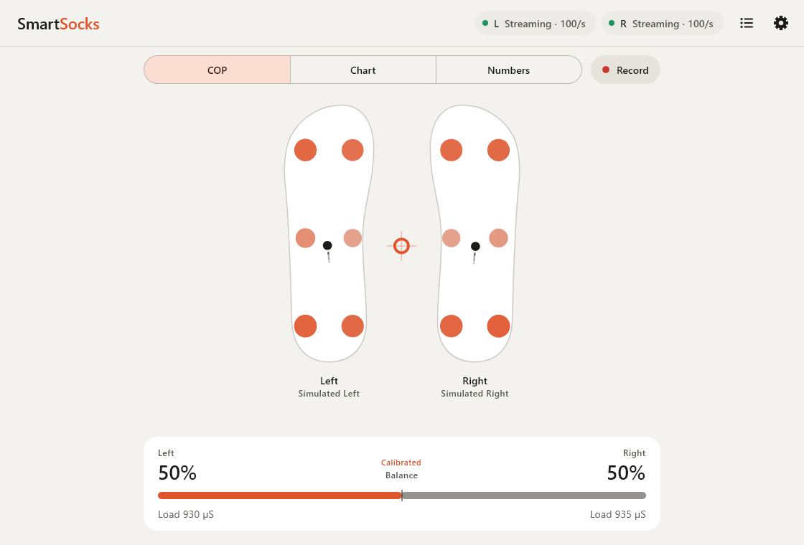
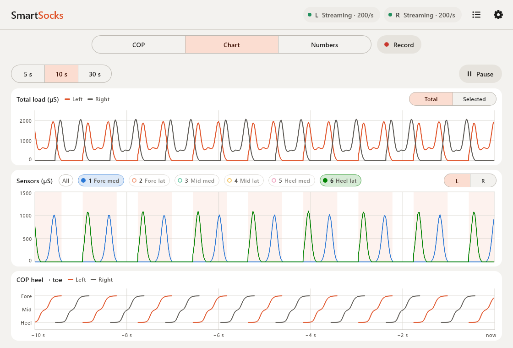
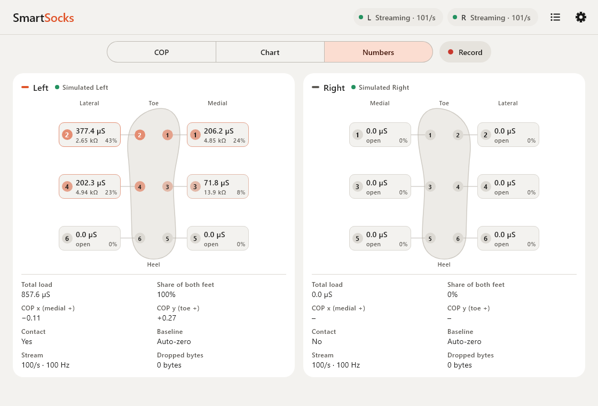
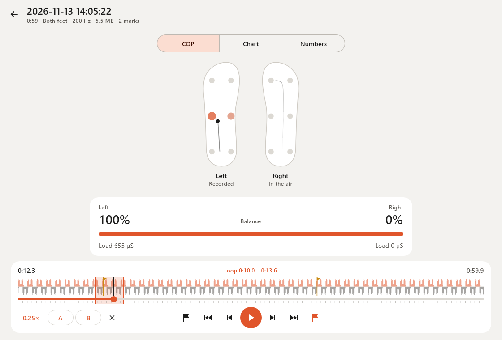

# SmartSocks

SmartSocks is the companion app for a pair of smart textile socks that measure how your weight is distributed
under each foot. Each sock has six pressure sensors knitted into the sole. A small clip-on unit streams their
readings over Bluetooth, and the app turns them into a live picture of plantar pressure, center of pressure (COP)
and left/right balance. It can also record a session and play it back frame by frame.

It runs on **Android** and **Windows** from one Kotlin Multiplatform codebase. A built-in simulator stands in for
the socks, so you can try everything without the hardware.



## Background

The sock system was built as a bachelor's thesis project and used in a usability study with athletes. In that study,
athletes performed single-leg squats and used the app's COP feedback to correct their foot pressure position:

> G. Semjonova, A. Davidovica, N. Kozlovskis, A. Okss, A. Katashevs.
> **Smart Textile Sock System for Athletes' Self-Correction during Functional Tasks: Formative Usability Evaluation.**
> *Sensors* 2022, 22(13), 4779. [doi:10.3390/s22134779](https://doi.org/10.3390/s22134779) ·
> [PMC9268753](https://pmc.ncbi.nlm.nih.gov/articles/PMC9268753/)

This repository is a from-scratch rewrite of that app. The original was single-foot and Android-only; it is archived as [SensorApplication](https://github.com/4oy3eh/SensorApplication). The
rewrite connects both feet at once, is tested end to end, and keeps the UI smooth at the full sensor rate.

## The hardware

- **Sensors.** Six force-sensitive resistors (FSR) per sock: two under the metatarsals, two under the arch and two
  on the heel, one medial and one lateral in each row. They are numbered 1–6: forefoot medial, forefoot lateral,
  midfoot medial, midfoot lateral, heel medial, heel lateral. The right sock mirrors the left.
- **Acquisition unit.** Snaps onto the sock and sits at the front of the shoe. It measures up to 8 channels at up to
  200 Hz per channel and runs about 8 hours on a LiPo battery.
- **Link.** Classic Bluetooth, Serial Port Profile (SPP). Android talks to the sock over an RFCOMM socket; on Windows
  a paired sock appears as a COM port.

## Features

- **Two feet at once.** Each foot is its own independent connection with a live status, and it reconnects
  automatically after a dropout.
- **Live views:**
  - **COP:** both insoles with each sensor coloured by load, the COP of each foot with a fading trail, the combined
    COP between the feet, and the left/right balance.
  - **Chart:** scrolling 5/10/30 s plots of the load per foot or the sum of the sensors you pick, every sensor of one
    foot separately, and the heel-to-toe COP path.
  - **Numbers:** an insole map with each sensor's load, resistance and share, plus totals, COP, contact and stream
    health.
- **Calibration:**
  - **Zero point:** lift the foot for 2 s to remove the sensors' unloaded reading. Auto-zero keeps it right during
    walking.
  - **Balance (L/R):** shift your weight from side to side for 10 s. This corrects the sensitivity difference between
    the two insoles without assuming you stand 50/50, so your real asymmetry still shows.
- **Recording:** saves the processed data to CSV and the raw packets alongside it, with markers. Recording continues
  in the background on Android and across reconnects. A foot that connects late joins the running recording.
- **Player:** opens a recording like a video, with a time slider, 0.1×–4× speed, frame stepping, jumps to the next
  heel strike or marker, A–B loop, and an overview strip of the whole session. It uses the same COP, Chart and
  Numbers views as live mode.
- **Without hardware:** pick the simulator (walking, standing, lifted, weight shifting) or replay a recorded raw dump
  as if it were a live sock.

| Chart | Numbers | Player |
|---|---|---|
|  |  |  |

## How the numbers are computed

1. **Resistance.** Each packet carries a 16-bit count per channel. The count is converted to resistance using the
   measurement range the sock was set to. A full-scale count means an open circuit, that is, no load.
2. **Load.** An FSR's conductance (1/R) grows roughly linearly with force. The app therefore uses conductance in
   microsiemens (µS) as the load, after subtracting the unloaded baseline.
3. **Contact.** A foot counts as on the ground when its total load crosses an on threshold, and as lifted when it
   drops below a lower off threshold.
4. **COP.** The center of pressure is the load-weighted mean of the sensor positions, smoothed with a 1€ filter.
5. **Balance.** Each foot's share of the combined load gives the left/right balance.

The loads are relative units (µS), not newtons. The app is a measurement and feedback tool, not a medical device.

## Running it

You need **JDK 21**, plus the **Android SDK** for the Android build. Gradle is bundled with the wrapper.

```bash
./gradlew check                       # format check (ktlint) + all tests
./gradlew :app-desktop:run            # desktop app
./gradlew :app-android:installDebug   # install on a connected device or emulator
```

Both feet start on the simulator. Pick a real sock under the gear icon:

- **Windows:** pair the sock in the Windows Bluetooth settings first. It then appears as a COM port.
- **Android:** pair the sock in the system Bluetooth settings, then pick it from the paired devices list.

## Project layout

| Module | Contents |
|---|---|
| `core/` | Platform-independent logic, fully unit-tested: packet protocol and decoder, calibration, load, COP, filters, balance, simulator and raw-dump replay, session handling, recording format and the playback engine. |
| `transport-desktop/` | Bluetooth sock as a serial COM port (jSerialComm). |
| `transport-android/` | Bluetooth sock over an RFCOMM socket. |
| `app/` | The shared Compose Multiplatform UI and app logic. |
| `app-desktop/`, `app-android/` | Thin platform entry points. |

Notes on the device protocol and the formulas: [docs/legacy-analysis.md](docs/legacy-analysis.md) (in Russian).

## Status

The app is complete on the simulator and on replayed data. It has not yet been tested end to end with real socks.
Some protocol details still have to be confirmed on the hardware: the start command order, a few unknown packet
bytes and which Bluetooth connection method works.

## Citation

If you use this work, please cite the study:

```bibtex
@article{semjonova2022smartsocks,
  title   = {Smart Textile Sock System for Athletes' Self-Correction during Functional Tasks: Formative Usability Evaluation},
  author  = {Semjonova, Guna and Davidovica, Anna and Kozlovskis, Nikita and Okss, Aleksandrs and Katashevs, Aleksejs},
  journal = {Sensors},
  volume  = {22},
  number  = {13},
  pages   = {4779},
  year    = {2022},
  doi     = {10.3390/s22134779}
}
```
